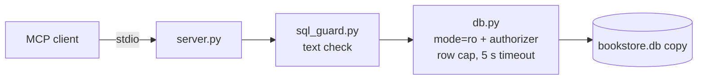

# sql-mcp-server

A small MCP server that lets an MCP client ask questions about a SQLite bookstore database, read-only.

I wanted to see what it takes to give a language model database access without trusting it, or me, to get the SQL right. The answer I settled on is three checks that each work alone, plus tests that try to break them.

Real output from `scripts/test_client.py`, which starts the server and calls it over stdio (trimmed; full file in [docs/sample_client_output.txt](docs/sample_client_output.txt)):

```text
tools: ['list_tables', 'describe_table', 'run_select', 'monthly_sales', 'top_books', 'low_stock', 'top_customers']

=== top_books(3)
{ "columns": [ "title", "author", "units", "revenue" ], "rows": [ [ "The Last River", "Ava Patel", 320, 7578.4 ], [ "The Lost River", "Amir Garcia", 146, 5168.14 ], [ "The Hidden Orchard", "Liam Cohen", 196, 4634.84 ] ], "row_count": 3, "truncated": true }

=== run_select('DROP TABLE books')
ERROR: Error executing tool run_select: only SELECT queries are allowed

=== run_select('SELECT 1; DELETE FROM books')
ERROR: Error executing tool run_select: only one statement is allowed
```

## Quick start

Requires Python 3.11 or newer (the 1 MB value cap uses `Connection.setlimit`, added in 3.11).

```bash
git clone https://github.com/YazanAlshareef/sql-mcp-server
cd sql-mcp-server
pip install -r requirements.txt
python -m pytest -q
python scripts/test_client.py
```

The data is a copy of the synthetic database from my `sql-bookstore-analytics` project: made-up names, `@example.com` emails, fake ISBNs. No real customer data.

## How a call flows



## Diagrams

- [Architecture](docs/diagrams/architecture.md): components and how they connect
- [run_select flow](docs/diagrams/run-select-flow.md): one call through the guard, the read-only connection and the authorizer
- [Data model](docs/diagrams/data-model.md): bookstore tables and foreign keys

## What it exposes

| Kind | Name | What it does |
|---|---|---|
| tool | `list_tables` | table names |
| tool | `describe_table` | columns, foreign keys, row count |
| tool | `run_select` | one `SELECT` or `WITH ... SELECT`, max 500 rows, 5 second timeout |
| tool | `monthly_sales` | revenue and orders per month, optional year |
| tool | `top_books` | best sellers by revenue |
| tool | `low_stock` | books at or below a stock threshold |
| tool | `top_customers` | biggest spenders |
| resource | `schema://bookstore` | the `CREATE TABLE` statements |
| prompt | `analyze_sales_by_month` | asks the model to analyze monthly sales with the tools |

Revenue counts `completed` orders only: `quantity * unit_price_cents`, shown in dollars. Stock is the sum of `inventory_movements.quantity_change`, because the source database never stores stock directly.

## How it stays read-only

Three layers. A bug in one should not be enough.

1. `sql_guard.py` strips comments and string contents, rejects a `;` in the middle, and requires the first word to be `SELECT` or `WITH`.
2. The database opens with SQLite `mode=ro`, so SQLite itself refuses writes.
3. A SQLite authorizer allows only select, read and function actions. `INSERT`, `DELETE`, `ATTACH` and `PRAGMA` are denied even if they get past layer 1, for example `WITH x AS (...) DELETE ...`.

On top of that: a row cap (500 max, 100 default), a 5 second timeout through a progress handler, and `randomblob` and `zeroblob` are denied because one call can allocate a huge value. BLOBs in results show as `<blob N bytes>` so they survive JSON.

### What the tests try

These run in `tests/test_security.py`. Each attack must fail, and a final check confirms the database file hash did not change.

| Attack | Result |
|---|---|
| `INSERT`, `UPDATE`, `DELETE` | rejected by the guard |
| `DROP`, `CREATE`, `ALTER`, `VACUUM`, `BEGIN` | rejected by the guard |
| `ATTACH 'x.db' AS x` | rejected by the guard |
| `PRAGMA user_version = 9` and other pragma writes | rejected by the guard |
| `SELECT 1; DELETE ...` (second statement) | rejected by the guard |
| lowercase keywords, leading comment tricks | rejected by the guard |
| empty query | rejected by the guard |
| `WITH x AS (SELECT 1) INSERT / UPDATE / DELETE ...` | passes the guard on purpose, stopped by SQLite (`sqlite3.DatabaseError`) |
| write on a plain connection | refused by `mode=ro` (tested on its own) |
| any write on the authorizer alone | denied (tested on its own) |
| `zeroblob(1000000000)`, `randomblob(...)` | denied by the authorizer |
| endless recursive query | stopped by the timeout |
| table name with SQL in it passed to `describe_table` | rejected, name must exist in `sqlite_master` |

Other tests cover the row limit, a path with a space and `#` in the folder name, BLOB values, and the business tools. `top_books` and `top_customers` match the sample output of queries Q02 and Q06 in my bookstore repo. `monthly_sales` and `low_stock` are not cross-checked against anything.

## Connect an MCP client

Most MCP clients take a JSON entry like this. Use your own absolute path.

```json
{
  "mcpServers": {
    "bookstore-sql": {
      "command": "python",
      "args": ["C:/path/to/sql-mcp-server/server.py"]
    }
  }
}
```

Set `BOOKSTORE_DB` to point at a different SQLite file.

## Why Python

The official Python SDK (`mcp`, its `FastMCP` helper) does the protocol work, and `sqlite3` ships with Python, so the SDK is the only dependency. My other portfolio projects are Python too. I built it against `mcp` 1.30; `requirements.txt` allows 1.30 up to, but not including, 2.

## How AI helped

An AI coding assistant wrote the first draft of the code and tests from my brief. I chose the scope (read-only, SELECT only, which tools), ran everything, and reviewed it. [WALKTHROUGH.md](WALKTHROUGH.md) explains each file so I can defend it.

## What broke

- **`describe_table` was denied by the authorizer.** `pragma_table_info(...)` counts as a `PRAGMA` action and I had denied all pragmas. Now only `table_info` and `foreign_key_list` are allowed.
- **My first client script showed empty results.** FastMCP fills `structuredContent` only for typed returns, and several tools return plain dicts. The client now reads the text content.
- **A `?` or `#` in the folder name broke the database URI.** I had built it with an f-string. It now uses `Path.as_uri()`, covered by a test.
- **A review found two rough edges.** Raw SQLite errors (bad SQL, unknown table) leaked through the tools, and revenue ties came back in no fixed order. Both are fixed and each has a test that failed before the fix.

## Limits

- SQLite only, with SQLite's dialect.
- The timeout stops CPU-heavy queries, but a query can still use memory until it fires. Any single value over 1 MB is refused (needs Python 3.11+).
- `run_select` can read every column, including the synthetic customer emails. Fine for fake data. For a real database you would need table and column allow-lists first.
- stdio only, no authentication. It runs as a local process for one user.
- I have only tested it with my own Python client script, not inside a desktop MCP app.
- `ruff` and `mypy` have not been run.

## License

MIT
