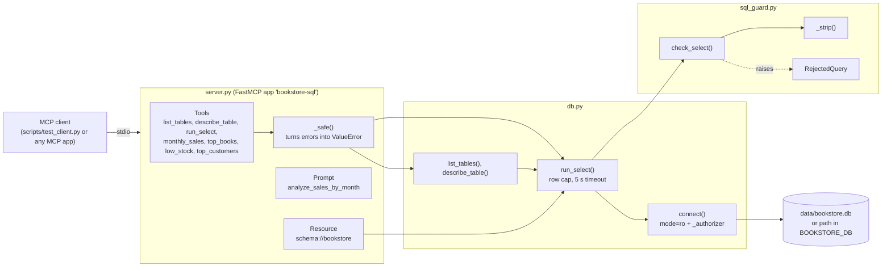

# Architecture

Components of the server and what each one does. Drawn from [server.py](../../server.py), [db.py](../../db.py) and [sql_guard.py](../../sql_guard.py).

The prompt only returns text. It does not touch the database.

Every query, including the fixed ones in `monthly_sales`, `top_books`, `low_stock`, `top_customers`, `describe_table` and the schema resource, goes through `db.run_select`. There is no other path to SQLite.
