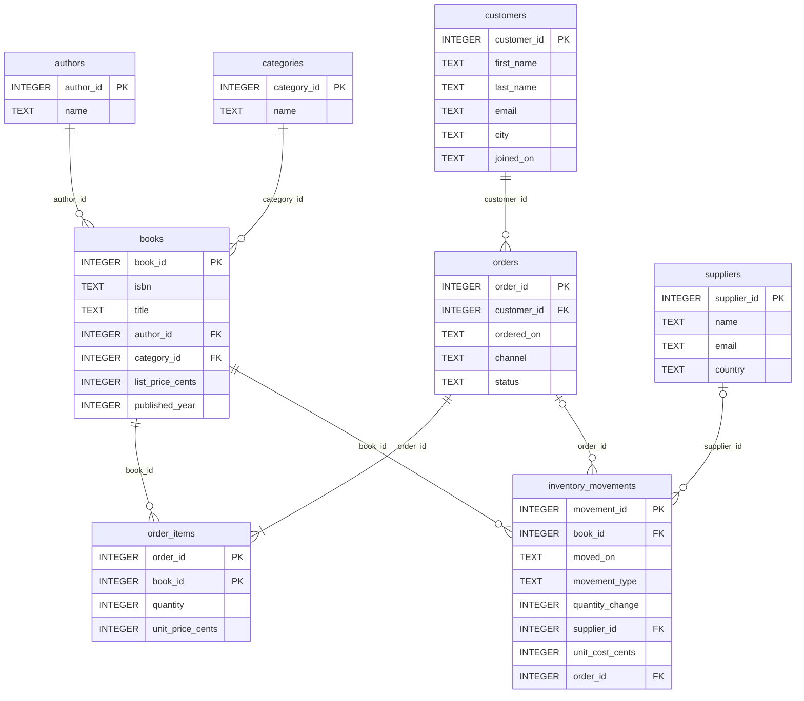

# Data model

Tables of the bookstore SQLite database and their foreign keys. Taken from the `CREATE TABLE` statements stored in [data/bookstore.db](../../data/bookstore.db) (also served by the `schema://bookstore` resource in [server.py](../../server.py)). The queries that use these tables are in [server.py](../../server.py).

`inventory_movements` also has a composite foreign key `(order_id, book_id)` to `order_items`. The diagram shows the two single-column links.
