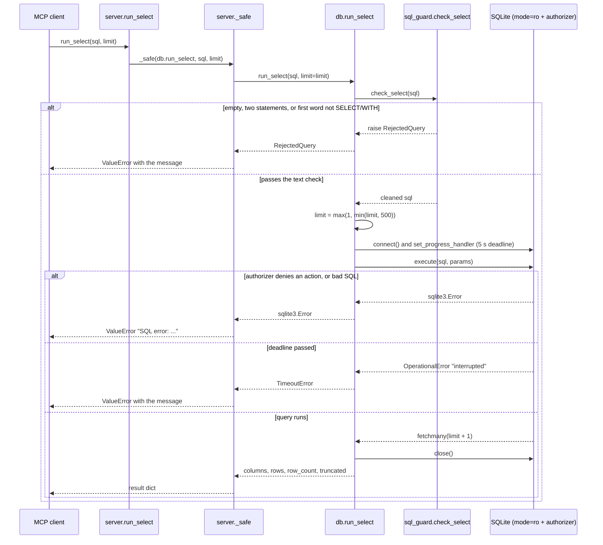

# run_select flow

One `run_select` call through the three read-only layers: the text guard, the read-only connection and the authorizer. Drawn from [server.py](../../server.py), [db.py](../../db.py) and [sql_guard.py](../../sql_guard.py).

A query like `WITH x AS (SELECT 1) DELETE ...` passes `check_select` because it starts with `WITH`. The authorizer then denies the delete, which is the second `alt` branch.
